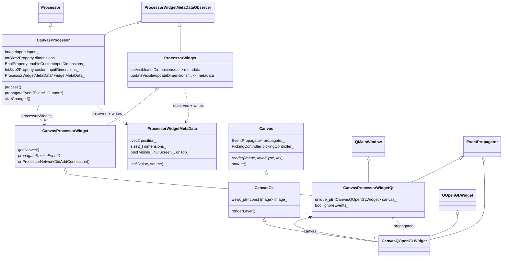
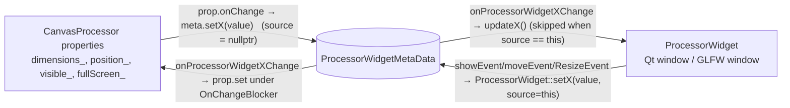
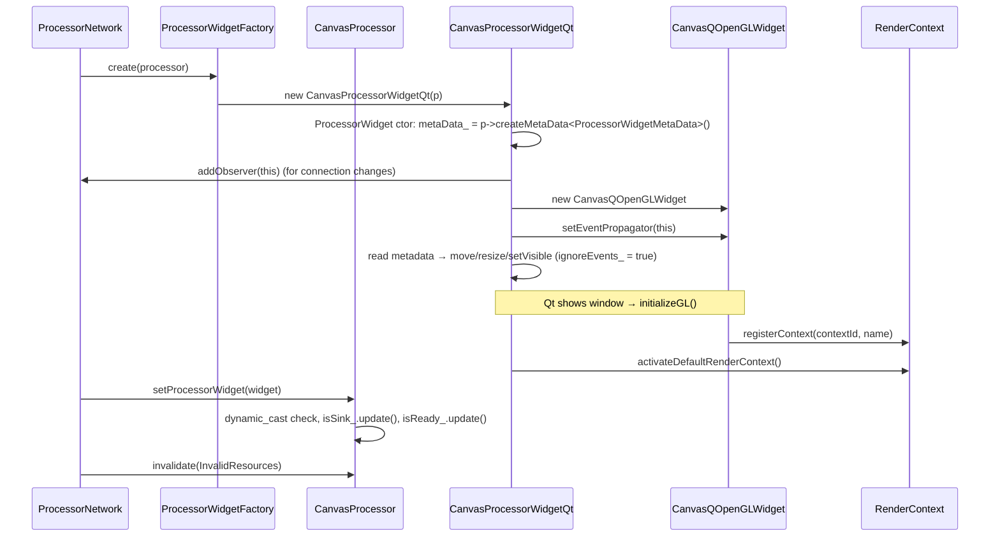
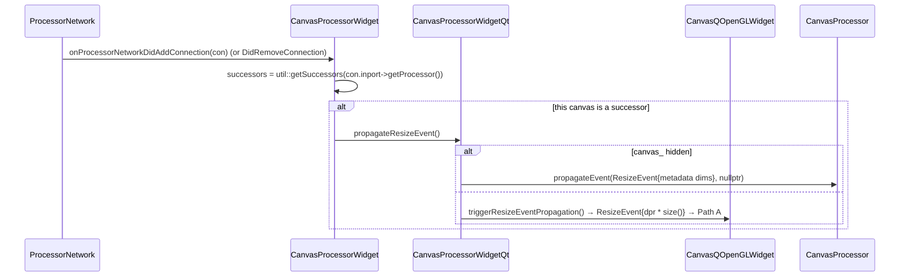

# Canvas Processors, Canvas Widgets and Canvases

This document describes how `CanvasProcessor`, `CanvasProcessorWidget`, `Canvas` and
their concrete subclasses cooperate to (a) put an image on screen and (b) tell the rest
of the network which image size to render. The three concerns are implemented by three
different class hierarchies that are glued together through `ProcessorWidgetMetaData`,
`ResizeEvent`, and a handful of callbacks, so the control flow is not visible from any
single file.

> Audience: developers touching canvas/widget code, implementing a new windowing
> backend, or debugging "wrong image size / canvas does not update / canvas position
> is not restored" problems.

---

## 1. Cast of Classes

| Role | Core (backend independent) | OpenGL | Qt | GLFW |
|---|---|---|---|---|
| Processor (network node, owns properties) | [`CanvasProcessor`](../../include/inviwo/core/processors/canvasprocessor.h) | [`CanvasProcessorGL`](../../modules/opengl/include/modules/opengl/canvasprocessorgl.h) (only adds `ProcessorInfo`) | [`CanvasWithPropertiesProcessor`](../../modules/openglqt/include/modules/openglqt/processors/canvaswithpropertiesprocessor.h) (*independent* re-implementation, not a `CanvasProcessor`) | – |
| Processor widget (the OS window) | [`ProcessorWidget`](../../include/inviwo/core/processors/processorwidget.h) → [`CanvasProcessorWidget`](../../include/inviwo/core/processors/canvasprocessorwidget.h) | – | [`CanvasProcessorWidgetQt`](../../modules/openglqt/include/modules/openglqt/processors/canvasprocessorwidgetqt.h), [`CanvasWithPropertiesProcessorWidgetQt`](../../modules/openglqt/include/modules/openglqt/processors/canvaswithpropertiesprocessorwidgetqt.h) | [`CanvasProcessorWidgetGLFW`](../../modules/glfw/include/modules/glfw/canvasprocessorwidgetglfw.h) |
| Canvas (GL surface that blits a `Layer`) | [`Canvas`](../../include/inviwo/core/util/canvas.h) | [`CanvasGL`](../../modules/opengl/include/modules/opengl/canvasgl.h) | [`CanvasQOpenGLWidget`](../../modules/openglqt/include/modules/openglqt/canvasqopenglwidget.h) | [`CanvasGLFW`](../../modules/glfw/include/modules/glfw/canvasglfw.h) |
| Shared state | [`ProcessorWidgetMetaData`](../../include/inviwo/core/metadata/processorwidgetmetadata.h) | | | |
| Size propagation | [`ResizeEvent`](../../include/inviwo/core/interaction/events/resizeevent.h), [`ImageOutport`](../../include/inviwo/core/ports/imageport.h) | | | |



Key ownership facts:

* The `Processor` owns the widget (`Processor::processorWidget_`, a `unique_ptr`). The widget
  is created by `ProcessorWidgetFactory` in
  [`ProcessorNetwork::addProcessor`](../../src/core/network/processornetwork.cpp) and
  destroyed (`setProcessorWidget(nullptr)`) in `ProcessorNetwork::removeProcessor`.
  Processors therefore have **no widget while outside a network** (unit tests, Python without
  a GUI, `inviwopyapp` without GLFW/Qt).
* The widget owns the `Canvas`. The processor never owns a canvas; it only reaches it via
  `CanvasProcessorWidget::getCanvas()`.
* The `Canvas` holds a *non-owning* `EventPropagator*`. For Qt this is the **widget**
  (`CanvasProcessorWidgetQt`), for GLFW it is the **processor** directly.
* The `ProcessorWidgetMetaData` is owned by the processor's `MetaDataOwner` and is the only
  thing that is **serialized** for position/size/visibility/fullscreen/onTop. The
  corresponding properties on `CanvasProcessor` have `PropertySerializationMode::None`.

---

## 2. Three Copies of the Same State

Window geometry/visibility exists in three places that have to be kept in sync:

1. **`ProcessorWidgetMetaData`** – the serialized source of truth.
2. **Properties on the processor** (`dimensions_`, `position_`, `visible_`, `fullScreen_`),
   so the user can edit them in the property list and link them.
3. **The actual OS window** (`QMainWindow` geometry / `GLFWwindow`).

Synchronisation is done with an observer pattern plus two "don't echo back to me" guards:



* `ProcessorWidgetMetaData::setX(value, source)` notifies **all observers except `source`**.
  `ProcessorWidget::setX` passes `this`, so a window-originated change does not bounce back
  into `updateX()`. The processor's `onChange` lambdas pass `nullptr`, so both the widget *and
  the processor itself* are notified (the processor relies on this to run
  `isSink_.update()` etc. in `onProcessorWidgetVisibilityChange`).
* `CanvasProcessor::onProcessorWidgetXChange` writes the property under a
  `Property::OnChangeBlocker` to avoid `prop.onChange → meta.setX` re-entry.
* `CanvasProcessorWidgetQt` additionally has `ignoreEvents_`. `updateX()` (metadata → window)
  sets it while calling Qt, so that the resulting Qt `showEvent`/`moveEvent` does not write
  the (possibly OS-adjusted) value back into the metadata. It is also set in the constructor
  so that initial placement/`resize`/`setVisible` do not overwrite deserialized values.
  **`CanvasWithPropertiesProcessorWidgetQt` has no such guard** (see §9).

A useful invariant: *the metadata is always updated first; properties and window follow*.
Anything that wants to change the window should go through either the property or
`ProcessorWidget::setX`, never through Qt directly.

---

## 3. Lifecycle



Destruction (`ProcessorNetwork::removeProcessor`) calls `processor->setProcessorWidget(nullptr)`.
The Qt widget's `canvas_` has a custom deleter that activates the context, reparents the
canvas to `nullptr` (so `QMainWindow` does not double-delete it), deletes it, and finally
re-activates the default context. `~CanvasQOpenGLWidget` unregisters the context from
`RenderContext`.

`CanvasProcessor::~CanvasProcessor` also hides the widget and clears the canvas' propagator,
but in practice `processorWidget_` is already `nullptr` at that point because the network
reset it first.

---

## 4. The Render Path

`Canvas::render()` does **not** draw; it only records what to draw and schedules a draw.

```mermaid
sequenceDiagram
    participant E as ProcessorNetworkEvaluator
    participant P as CanvasProcessor
    participant W as CanvasProcessorWidgetQt
    participant C as CanvasQOpenGLWidget
    participant GL as CanvasGL

    E->>P: process()
    alt inport_.isChanged()
        P->>P: update colorLayer_ visibility / max
    end
    alt processorWidget_ && processorWidget_->isVisible()  (metadata)
        P->>W: getCanvas()
        P->>C: render(inport_.getData(), visibleLayer_, colorLayer_)
        alt QWidget::isVisible() && isValid()
            C->>GL: CanvasGL::render(image, type, idx)
            GL->>GL: image_ = image (weak_ptr); pickingController_.setPickingSource(image)
            GL->>C: update()
            C->>C: QOpenGLWidget::update()  → schedules paintGL
        end
    end
    Note over C: later, on the GUI thread
    C->>GL: paintGL() → CanvasGL::update() → renderLayer()
    alt image_.lock() && layer && LayerGL
        GL->>GL: bind texture, renderTexture() (full-screen quad)
    else
        GL->>GL: renderNoise()
    end
```

Notes:

* **Qt is deferred, GLFW is immediate.** `CanvasGLFW::update()` activates its context, calls
  `CanvasGL::update()` right away, swaps buffers, and re-activates the default context.
  `CanvasQOpenGLWidget::update()` only posts a paint request; `glSwapBuffers()` is a no-op
  because `QOpenGLWidget` composes into the widget stack.
* `CanvasGL::image_` is a **`weak_ptr`**. The canvas never keeps an image alive. If the
  image dies between `render()` and `paintGL()` noise is drawn (see §9).
* `CanvasProcessor::doIfNotReady()` calls `render(nullptr, …)` so a not-ready canvas shows
  noise rather than a stale image.
* `renderLayer()` is also what runs on plain expose/repaint events, re-blitting the last image.
* `CanvasGL::ready()` lazily sets up GL state, the quad mesh and shaders the first time the
  framebuffer is complete (works around an `INVALID_FRAMEBUFFER_OPERATION` on macOS).
* Only the canvas' own GL context is used for drawing. Everything else in the network runs on
  the *default* context; that is why resize code calls `rendercontext::activateDefault()`
  before touching upstream images.

---

## 5. The Resize Paths

There are **five** distinct ways a `ResizeEvent` enters the network from a canvas. All end up
in `CanvasProcessor::propagateEvent` → `ImageInport::propagateEvent` → `ImageOutport::propagateEvent`
and then recursively upwards.

### 5.1 Upstream handling (common tail)

```mermaid
sequenceDiagram
    participant P as CanvasProcessor
    participant IP as ImageInport
    participant OP as ImageOutport (upstream)
    participant UP as Upstream Processor

    P->>IP: propagateEvent(ResizeEvent)
    IP->>OP: propagateEvent(event, inport)
    OP->>OP: requestedDimensions_[inport] = size; pruneCache()
    OP->>OP: newDim = largest requested size
    alt handleResizeEvents_ == Yes
        OP->>OP: setDimensions(newDim) on owned image (+ sibling outports in same port group)
        OP->>UP: invalidate(InvalidOutput)
    end
    OP->>UP: propagateEvent(ResizeEvent{newDim}, this)
    UP->>UP: Processor::propagateEvent: for inports where ResizeEvent::shouldPropagateTo()
    Note over UP: only ImageInport / ImageMultiInport / DataInport<DataSequence<Image>><br/>in the same port group as the source outport
```

* A processor that gets a *smaller* request than another consumer keeps rendering at the
  largest size; `ImageOutport::getDataForPort(inport)` then hands that inport a resized copy
  from `ImageCache` (unless the inport has `OutportDeterminesSize::Yes`).
* `ImageOutport::disconnectFrom` removes the inport's request and sends a fresh `ResizeEvent`
  upstream, so disconnecting shrinks images automatically.
* `Event::markAsVisited` protects against diamonds; `CanvasProcessor::propagateEvent` and
  `Processor::propagateEvent` both honor it.
* The whole chain is wrapped in a `NetworkLock` (`CanvasQOpenGLWidget::propagateEvent`,
  `CanvasProcessor::propagateEvent`, `CanvasProcessorWidgetGLFW::propagateResizeEvent`) so
  the many `invalidate()` calls lead to one evaluation.

### 5.2 Path A – the user resizes the Qt window

```mermaid
sequenceDiagram
    participant Qt as Qt layout
    participant C as CanvasQOpenGLWidget
    participant PC as PickingController
    participant W as CanvasProcessorWidgetQt
    participant M as ProcessorWidgetMetaData
    participant P as CanvasProcessor

    Qt->>C: resizeEvent(QResizeEvent)   (non-spontaneous, from layout)
    C->>C: image_.reset(); picking source = nullptr; setUpdatesEnabled(false)
    C->>C: physical = round(dpr * event->size())
    C->>C: rendercontext::activateDefault()
    C->>PC: propagateEvent(ResizeEvent{physical}, propagator_)   [NetworkLock]
    PC->>W: propagateEvent(event, nullptr)   (no case for ResizeEvent → falls through)
    W->>M: CanvasProcessorWidget::setDimensions(physical)  (source = widget)
    M->>P: onProcessorWidgetDimensionChange → dimensions_.set (OnChangeBlocker)
    W->>P: propagateEvent(event, nullptr)
    P->>P: dimensions_.set(size)   (no-op, already equal)
    alt enableCustomInputDimensions_
        P->>P: sizeChanged()  → new ResizeEvent{customInputDimensions_} upstream
    else
        P->>P: inport_.propagateEvent(event); invalidate(InvalidOutput)
    end
```

The `ResizeEvent` carries **physical (device) pixels**; `QWidget::size()` is logical. This is
the only place in `CanvasProcessorWidgetQt` where logical→physical conversion must happen on
the way *in*; `setDimensions()` converts physical→logical on the way *out*.

### 5.3 Path B – the `dimensions_` property / metadata changes

```mermaid
sequenceDiagram
    participant U as User / deserialize / link
    participant P as CanvasProcessor
    participant M as ProcessorWidgetMetaData
    participant W as CanvasProcessorWidgetQt
    participant C as CanvasQOpenGLWidget

    U->>P: dimensions_.set(newPhysical)
    P->>M: dimensions_.onChange → setDimensions(newPhysical)   (source = nullptr)
    M->>P: onProcessorWidgetDimensionChange (equal → nothing)
    M->>W: onProcessorWidgetDimensionChange → updateDimensions(newPhysical)
    W->>W: ignoreEvents_ = true; setDimensions() → resize(round(newPhysical / dpr))
    Note over W,C: Qt lays out the central widget
    C->>C: resizeEvent → Path A from here on
```

So the property path *always goes through the real window* and relies on Qt to send a resize
event. Qt only sends resize events to hidden widgets when they are next shown, which matters
for `evaluateWhenHidden_` (see §9).

### 5.4 Path C – the network topology changed



This is what gives a newly connected upstream processor the correct size without any user
interaction. `ImageExport` does the same thing for its own inport. Every canvas in the network
runs this check for *every* connection added or removed.

### 5.5 Path D – custom input dimensions (`sizeChanged`)

Triggered by `enableCustomInputDimensions_`, `customInputDimensions_`, `keepAspectRatio_`,
`aspectRatioScaling_`, `inport_.onConnect`, `setCanvasSize()` and Path A when custom
dimensions are enabled.

```text
sizeChanged():
    NetworkLock; rendercontext::activateDefault()
    update sub-property visibility/read-only
    if keepAspectRatio_: customInputDimensions_ = calcScaledSize(dimensions_, aspectRatioScaling_)   (OnChangeBlocker)
    ResizeEvent{ enableCustom ? customInputDimensions_ : dimensions_ }
    inputSize_.invalidate(Valid, &customInputDimensions_)      // refresh widgets only
    inport_.propagateEvent(&resizeEvent)
```

In this mode the *window* size (`dimensions_`) and the *requested image* size
(`customInputDimensions_`) differ; `CanvasGL::renderTexture` simply stretches the texture to
the viewport.

### 5.6 Path E – GLFW

`CanvasGLFW` installs `glfwSetFramebufferSizeCallback` → `onFramebufferSizeChange` →
`CanvasProcessorWidgetGLFW::propagateResizeEvent()`:

```text
screenDimensions_ = canvas_->getFramebufferSize()
CanvasProcessorWidget::setDimensions(screenDimensions_)      // metadata, source = widget
NetworkLock; rendercontext::activateDefault()
getProcessor()->propagateEvent(ResizeEvent{screenDimensions_}, nullptr)
```

Simpler than Qt: no `PickingController`/`EventPropagator` detour, and the metadata ↔ window
sync uses `updateX()` directly in `setX()`. Framebuffer size is physical pixels, so the unit
convention matches Qt's.

### 5.7 `CanvasWithPropertiesProcessor`

A separate implementation (not a `CanvasProcessor`): same metadata sync via a `PWObserver`
helper, same `isSink_`/`isReady_` gating, but the metadata `dimensions_` is the **whole window
in logical pixels**, while the `ResizeEvent` sent upstream is still the **canvas in physical
pixels** (`CanvasQOpenGLWidget::resizeEvent`). Its `propagateResizeEvent()` always goes
through the canvas, and `propagateEvent()` for a resize overwrites the metadata with
`QMainWindow::size()` rather than the event size.

---

## 6. Visibility and Evaluation

`CanvasProcessor` is only a *sink* and only *ready* while its window is visible:

```text
setEvaluateWhenHidden(false)  (default):
    isSink_  = processorWidget_ && processorWidget_->isVisible()
    isReady_ = widget visible ? default inport check : NotReady("Canvas is not visible")
setEvaluateWhenHidden(true):
    isSink_  = true
    isReady_ = default inport check
```

`isVisible()` here is the **metadata** flag, not `QWidget::isVisible()`. `isSink_` controls
whether the evaluator starts a traversal from this processor at all, so hidden canvases (and
any upstream processors with no other visible consumer) are simply not evaluated. The state
coordinators are refreshed from `onProcessorWidgetVisibilityChange` and `setProcessorWidget`.

`CanvasQOpenGLWidget::render` has a second, independent gate (`QWidget::isVisible() &&
isValid()`), which protects against rendering before the GL context exists.

---

## 7. GL Context Discipline

* Every canvas has its own context, registered with `RenderContext` under `contextId()`.
* The *default* context (a hidden canvas created via `createHiddenCanvas()`) is used for all
  processing. Because a `ResizeEvent` makes upstream `ImageOutport`s call
  `Image::setDimensions`, which reallocates `LayerGL` textures, **every entry point that
  sends a `ResizeEvent` first calls `rendercontext::activateDefault()`**
  (`CanvasQOpenGLWidget::resizeEvent`, `triggerResizeEventPropagation`,
  `CanvasProcessorWidgetQt::propagateResizeEvent`, `CanvasProcessorWidgetGLFW::propagateResizeEvent`,
  `CanvasProcessor::sizeChanged`).
* `CanvasGLFW::update()` and the Qt canvas deleter restore the default context afterwards.
  `paintGL()` runs with Qt having already made the canvas context current.

---

## 8. Quick Reference: "Who writes what?"

| Trigger | Writes metadata? | Writes properties? | Resizes window? | Sends ResizeEvent? |
|---|---|---|---|---|
| User drags Qt window | yes (`source=widget`) | via observer | (already) | yes, physical size |
| `dimensions_` property set | yes (`source=nullptr`) | – | yes (`updateDimensions`) | indirectly, via Qt resize event (deferred if hidden) |
| `setCanvasSize()` | yes (via property) | yes | yes | yes, immediately (`sizeChanged`) |
| Connection added/removed | no (hidden) / yes (visible, same value) | – | no | yes |
| Custom input dims toggled | no | yes | no | yes, with custom size |
| Deserialization | yes | via observer | yes (ctor reads metadata) | via Qt resize event |
| GLFW framebuffer callback | yes | via observer | (already) | yes |

---

## 9. Known Bugs and Edge Cases

1. **`CanvasWithPropertiesProcessorWidgetQt` has no `ignoreEvents_` guard** – the constructor
   comment says "prevent move events" but nothing does; `Super::move(newPos)` triggers
   `moveEvent` → `setPosition(adjusted)`, overwriting the deserialized position. Same for the
   initial `resize` and `setVisible`.
2. **Inconsistent size units between widgets** – `CanvasProcessorWidgetQt` and GLFW use
   physical pixels in the metadata; `CanvasWithPropertiesProcessorWidgetQt` uses logical
   pixels (its header comment claims this is "consistent with other widget"). Workspaces moved
   between DPIs behave differently per processor type.
3. **Hidden canvas + `evaluateWhenHidden_` + size change** – Path B relies on Qt's resize
   event, which Qt defers for hidden widgets until they are shown. Upstream therefore keeps
   rendering the old size (e.g. when saving images from a hidden canvas). `setCanvasSize()`
   avoids it by calling `sizeChanged()` directly; the property path does not.
4. **Window-system full-screen changes are not written back** in `CanvasProcessorWidgetQt`
   (no `changeEvent` override; e.g. macOS green button / Esc). `CanvasWithProperties…` has the
   override but, conversely, its `setFullScreen` relies solely on it.
5. **`weak_ptr` image and deferred paint** – If the image is destroyed between `render()` and
   `paintGL()` (e.g. `ImageCache::prune` after a resize, or an upstream `setData` with a new
   object), the canvas falls back to noise for a frame. `resizeEvent` also resets `image_`, so
   every window resize shows noise until the next evaluation finishes (intended, but visible).
6. **Resize storm on workspace load** – `onProcessorNetworkDidAddConnection` runs for every
   canvas on every connection, computes `getSuccessors()` (full downstream traversal) and sends a
   `ResizeEvent` that reallocates all upstream textures. Cost is
   O(connections × canvases × network) plus GPU allocations; nothing coalesces this while the
   network is locked.
7. **Initial DPR guess** – the constructor reads `window()->devicePixelRatio()` before the
   window is placed on its final screen. On mixed-DPI multi-monitor setups the first logical
   size is wrong until the first real resize event.
8. **Minimized windows still evaluate** – `QWidget::isVisible()` and the metadata flag stay
   `true` while minimized, so hidden-but-minimized canvases keep the pipeline alive.
9. **Latent destructor hazard** – `~CanvasProcessor` calls `processorWidget_->setVisible(false)`
   which can call back into `onProcessorWidgetVisibilityChange → invalidate()` on a
   half-destroyed processor. Today it is unreachable because the network nulls the widget
   first, but a processor destroyed outside a network with a widget would hit it.

---

## 10. Simplification Opportunities

1. **One unit, two helpers.** Decide that metadata and `ResizeEvent` are *physical pixels*
   everywhere (what core already assumes), add `toLogical()/toPhysical()` helpers on the Qt
   widget, and route every conversion through them. Fixes §9 (2) and (7) and makes
   `CanvasWithProperties…` consistent.
2. **Don't send `ResizeEvent` through `PickingController`/`EventPropagator`.** Give
   `CanvasQOpenGLWidget` an `std::function<void(size2_t)> onResize` that the owning widget sets.
   `resizeEvent` and `triggerResizeEventPropagation` call it; the widget then does
   `setDimensions(metadata)` + `getProcessor()->propagateEvent(...)`. The resize path becomes
   linear (Qt → canvas → widget → processor) and the widgets' `propagateEvent` overrides lose
   their resize special-case.
3. **Single code path in `CanvasProcessor::propagateEvent`.** Since metadata already drives
   `dimensions_` through the observer, the resize branch can be:
   `NetworkLock; dimensions_.set(size); sizeChanged(); invalidate(InvalidOutput);`
   `sizeChanged()` already builds the correct event for both the custom and non-custom case,
   so the `if (enableCustomInputDimensions_)` fork disappears. Also replace the
   `hasVisitedProcessor` + `markAsVisited` pair with `if (!event->markAsVisited(this)) return;`.
4. **Simplify `propagateResizeEvent`.** Both Qt branches can become
   `getProcessor()->propagateEvent(ResizeEvent{getDimensions()}, nullptr)` because the metadata
   is kept in sync by Path A; visibility no longer matters. (`CanvasWithProperties…` must use
   `canvas_->getCanvasDimensions()` since its metadata holds the window size.)
5. **Coalesce topology-triggered resizes.** In `CanvasProcessorWidget`, set a dirty flag in
   `onProcessorNetworkDid{Add,Remove}Connection` and send one `ResizeEvent` from
   `onProcessorNetworkUnlocked()` (or immediately if the network is not locked). Removes the
   load-time storm §9 (6) and makes the successor traversal happen once per lock scope.
6. **Share the Qt widget implementation.** `CanvasProcessorWidgetQt` and
   `CanvasWithPropertiesProcessorWidgetQt` duplicate constructor placement logic, the context
   menu, show/hide/move handlers and all `set*/update*` pairs. Either derive the latter from the
   former (replacing the central widget with the splitter) or extract a
   `CanvasProcessorWidgetQtBase`. This also gives the "with properties" variant the
   `ignoreEvents_` guard for free, §9 (1).
7. **Share the processor-side metadata sync.** `PWObserver` in `CanvasWithPropertiesProcessor`
   re-implements `CanvasProcessor`'s observer callbacks and `isSink_/isReady_` setup. A small
   intermediate base (`CanvasProcessorBase`: inport, the five window properties, metadata sync,
   visibility-gated sink/ready, `Exporter`/`ImageExporter`) would let both processors drop ~100
   lines each and share future fixes (e.g. §9 (4)).
8. **Make the property path not depend on Qt's deferred resize.** Have
   `CanvasProcessor::onProcessorWidgetDimensionChange` (or `dimensions_.onChange`) call
   `sizeChanged()` itself when `evaluateWhenHidden_` is set, or always; then Path B does not
   depend on the window delivering a resize event and §9 (3) disappears.
